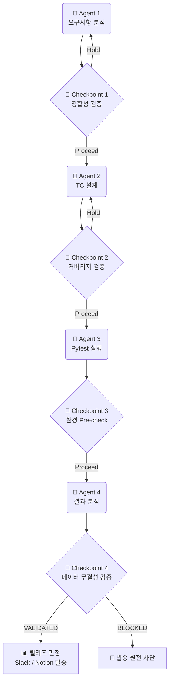

# 🚀 QA 파이프라인 최종 아키텍처 및 로직 명세서

본 문서는 프로젝트 진행 과정에서 고도화된 **Agent(실행 주체)**와 **Checkpoint(검증 게이트)**의 역할, 세부 로직, 판정 기준, 그리고 표준화된 용어 체계를 완벽하게 분리하여 정리한 최종 명세서입니다.

> [!TIP]
> **단일 진실의 원천 (Single Source of Truth)**
> 이 파이프라인의 최종 목적지는 외부 개입 없이 100% 추적 가능한 `agent4_summary.json`과 `checkpoint4_validation.json`을 생성하여 대시보드(포트폴리오)와 연동하는 것입니다.

---

## 🗺️ 파이프라인 워크플로우

---

## 0. 공통 용어 및 상태 표준화

파이프라인 전체를 관통하는 핵심 용어들을 표준화하여 모호성을 제거했습니다.

| 구분 | 표준 용어 | 설명 |
| :--- | :--- | :--- |
| **진행 상태** | `전체 진행 (Proceed)` | 모든 검증을 통과하여 다음 단계로 넘어감 |
| | `일부 진행 (Partial Proceed)` | 치명적 결함은 없으나 수정 권고가 있어 조건부로 넘어감 |
| | `확인 후 진행 (Hold)` | 크리티컬한 결함/모호성으로 인해 컷오프(차단)됨 |
| **상태 격리** | `사용자 UI` | 화면에 표시되는 시각적 상태 및 피드백 |
| | `내부 장치 상태` | 백엔드/시뮬레이터가 실제로 가지고 있는 데이터 상태 |
| **TC 용어** | `기대결과 (Expected Result)` | 결과 도출을 설명하는 표준 명칭 |
| | `통합 테스트 (E2E)` | 엔드투엔드 시나리오의 표준 명칭 |

---

## 1. Agent (실행 주체) 상세 명세

### 🤖 Agent 1: 요구사항 분석 에이전트
기획서, 요구사항 명세서를 읽고 누락되거나 모호한 기획의 빈틈을 찾아냅니다.
* **모호성 감지 (기획 누락)**: 에러 상황은 정의되었으나, 이에 따른 구체적인 시스템 피드백(예: CH05 에러 발생 시 UI 색상 변화 기준)이 문서에 명확하지 않은 경우 "요구사항 모호성"으로 판정합니다.

### 🤖 Agent 2: TC 설계 에이전트
확정된 기획을 바탕으로 엣지 케이스와 상태 격리가 포함된 구체적인 TC를 설계합니다.
* **추적성 매핑**: 목적 기반 ID 체계(`TC-MODE-001`, `TC-ENV-000`)를 도입하고, 요구사항의 `CRIT(Criteria)` ID와 완벽히 매핑합니다.
* **상태 격리 (State Isolation)**: 하나의 TC가 너무 많은 것을 검증하여 연쇄 실패가 일어나지 않도록, `사용자 UI` 검증과 `내부 장치 상태` 검증을 분리하여 검증합니다.
* **Boundary(경계값) 검증**: 30°C 초과 조작 시도 등 한계값 도달 시, 시스템 방어 로직(Toast 알림, 롤백)이 동작하는지 필수로 설계합니다.

### 🤖 Agent 3: 자동화 테스트 실행 (Pytest)
설계된 TC를 실제 코드로 변환하여 시뮬레이터에서 실행하고 원본 데이터를 남깁니다.
* **Demo 정직성 (Simulator Honesty)**: 시뮬레이터 내부 응답은 실제 피드백을 모사하며, 테스트 패스를 위해 결과를 절대 조작하지 않습니다.
* **메타데이터 강제 주입**: `conftest.py`를 통해 모든 실행 결과에 `run_id`, `tc_id`, `duration`, `evidence_path(스크린샷)`를 강제로 기록하여 추적성을 부여합니다.

### 🤖 Agent 4: 결과 분석 및 보고 (Reporting Manager)
실행된 결과를 파싱하여, 단순 성공 여부를 넘어 **QA 원인**을 분류하고 릴리즈 의사결정을 내립니다.

**[ 5가지 QA 원인 분류 ]**
1. `product_defect` (제품 결함): 명확하게 소프트웨어가 스펙대로 동작하지 않음
2. `requirement_review` (요구사항 확인 필요): 기획서 기준 미비로 Assert가 불가능함
3. `environment_issue` (환경/시뮬레이터 문제): 제어 명령 후 응답 Timeout 발생 등
4. `automation_issue` (자동화 코드 문제): DOM 변경 등 Playwright 스크립트 에러
5. `not_executed` (미실행): 사전 조건 불만족으로 스킵됨

**[ 실행 및 릴리즈 판정 로직 ]**

| 구분 | 판정 로직 |
| :--- | :--- |
| **실행 판정 (Execution)** | **`FAILED`**: 원인(결함/환경) 불문하고 Failed나 Error가 1건이라도 존재 **`INCOMPLETE`**: 실패는 없으나 Skipped가 존재 **`PASSED`**: 100% Passed |
| **릴리즈 판정 (Release)** | **`HOLD`**: 실행 판정이 `FAILED`이거나, `요구사항 확인` 또는 `미실행`이 1건이라도 존재 **`PASS`**: 완전한 통과 및 모호성 제로 |

> [!WARNING]
> 환경 문제(네트워크 오류 등)로 인해 실패한 경우라도, 테스트 결과는 무조건 `FAILED`이며 릴리즈는 `HOLD` 처리됩니다. 임의로 통과시켜주지 않습니다.

---

## 2. Checkpoint (데이터 검증 게이트) 상세 명세

각 Agent가 다음 단계로 넘어가기 전, 산출물의 데이터 무결성과 품질을 컷오프(Cut-off) 하는 안전장치입니다.

### 🛑 Checkpoint 1: 요구사항 정합성 검증
* **위치**: Agent 1 ➔ Agent 2
* **검증 내용**: 요구사항 명세서 내 상충되는 룰(예: 모드 규칙 충돌)이 없는지, 누락된 스펙(모호성)이 모두 해소되었는지 검증합니다. 실패 시 `HOLD` 처리됩니다.

### 🛑 Checkpoint 2: TC 커버리지 및 추적성 검증
* **위치**: Agent 2 ➔ Agent 3
* **검증 내용**: 
  * **교차 검증 (Cross-Validation)**: 해피 패스만 작성되지 않고, 네거티브/엣지 케이스가 교차 검증되었는지 컷오프합니다.
  * **추적성 매핑**: `TC-ID`가 요구사항의 `CRIT` ID와 1:1 이상으로 완벽히 매핑되었는지 검사합니다.

### 🛑 Checkpoint 3: 자동화 실행 환경 Pre-check
* **위치**: Agent 3 실행 직전
* **검증 내용**: 테스트 대상 시스템(가상 레지스터) 상태가 초기화되어 완벽한지 사전 검증(`TC-ENV-000`)하여, 환경 불량으로 인한 가짜 실패(False Negative)를 방지합니다.

### 🛑 Checkpoint 4: 최종 데이터 무결성 교차 검증
* **위치**: Agent 4 내부 (외부 리포팅 발송 전)
* **검증 내용**:
  * **양방향 교차 검증**: `qa_results.json`과 `report.html`의 데이터를 뜯어 총 실행 건수, Test ID, Pytest 상태(Pass/Fail)가 100% 일치하는지 비교합니다.
  * **논리 조합 방어 (`ALLOWED_STATUS_CLASSIFICATIONS`)**: `Passed` 상태인데 QA 원인이 `product_defect`로 분류되는 등 논리적으로 불가능한 조작을 차단합니다.
* **판정**:
  * **`VALIDATED`**: 데이터 조작 없음 보증. 실패 내역이 있더라도 조작되지 않았다면 VALIDATED 부여 후 외부로 리포팅(Slack/Notion) 허용.
  * **`BLOCKED`**: 불일치 발생 시 원천 차단. 외부 리포팅 중단.
